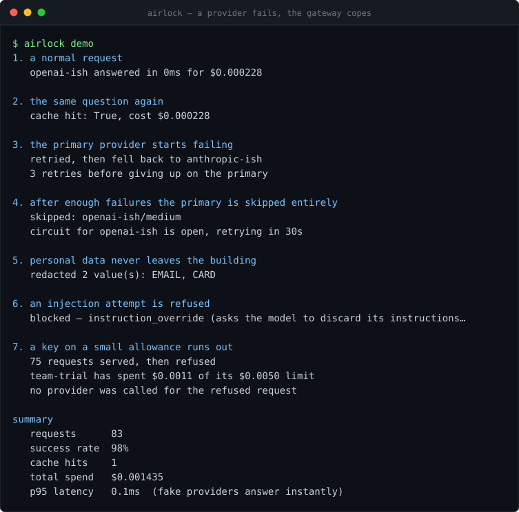

# airlock

[](https://github.com/KRISH123no/airlock/actions/workflows/ci.yml)



**A checkpoint every AI request passes through.**

Calling a model is one line of code. Running that line a hundred thousand times a day is a
different problem: the provider goes down, a bad loop burns $40,000 overnight, a customer pastes
their card number into the chat, the model returns almost-JSON and your parser dies, and when
someone asks *"why was that answer slow?"* nobody can say.

airlock sits between your app and the model. It retries, fails over to another provider, stops
spending at a limit, remembers answers it has seen, strips personal data before it leaves your
network, blocks injection attempts, and records what happened to every single request.

No runtime dependencies in the library. FastAPI only for the optional server.

```bash
pip install -e ".[dev]"
python -m airlock demo                 # the run above — offline, no API key
python -m airlock serve                # gateway + dashboard on :8000
```

## What it actually does

| | |
|---|---|
| **Retries** | Only failures that could succeed on a second try. A 500 gets retried; a malformed request does not, because it will be malformed again |
| **Backoff** | Exponential with *full jitter*, so clients that failed together do not retry together and knock the provider over again |
| **Failover** | An ordered chain of providers. When the primary is down the request moves to the next one, mid-flight, without the caller noticing |
| **Circuit breaking** | A provider that keeps failing stops receiving traffic entirely, then gets probed carefully before being trusted again |
| **Budgets** | Per key, on a rolling window, enforced *before* the call |
| **Caching** | Exact match, plus optional semantic matching so near-identical prompts share an answer |
| **Redaction** | Emails, cards, phone numbers, API keys swapped for placeholders on the way out and restored on the way back |
| **Injection screening** | Heuristic detection of prompt-injection attempts, with a score and the reasons |
| **Schema repair** | Structured output validated against JSON Schema, with the common malformations fixed locally |
| **Tracing** | Every attempt recorded — including the failed ones, which are the interesting ones |

## Drop-in

The completions endpoint speaks the OpenAI request shape, so an existing app switches over by
changing a base URL:

```python
client = OpenAI(base_url="http://localhost:8000/v1", api_key="unused")
```

The response carries an extra `airlock` block with what the gateway knows:

```json
{
  "choices": [{ "message": { "role": "assistant", "content": "..." } }],
  "airlock": {
    "trace_id": 41, "provider": "anthropic-ish", "cached": false,
    "cost_usd": 0.000016, "latency_ms": 96.4, "retries": 3,
    "guardrails": ["redacted 2 value(s): EMAIL, CARD"]
  }
}
```

`python -m airlock serve` also puts a dashboard on `/` — request count, success rate, cache hit
rate, spend, p50/p95/p99, live circuit-breaker state per provider, and the last requests with what
each one cost and what tripped on it.

## Four decisions worth defending

**Budget is reserved before the call, not counted after it.** The obvious design — add up what has
been spent, compare to the limit, then call — breaks the moment two requests are in flight. Both
read "plenty left", both proceed, and together they overshoot. With slow model calls and real
concurrency the overshoot is not marginal. So airlock reserves the worst-case cost up front and
commits the actual cost afterwards. There is a test that fails on the naive version.

**The reservation covers the priciest model in the chain.** If the primary is cheap and the
fallback is expensive, reserving only the primary's cost lets a request slip past its budget by
failing over. Reserve the maximum.

**A schema failure does not trip the provider's circuit breaker.** The provider answered — it is
healthy. Bad formatting is not ill health, and counting it as such would take a working provider
out of rotation.

**A cache hit does not touch the budget.** An answer you already have costs
nothing, so it should not consume an allowance. Cache is checked before budget, deliberately.

## Testing

```bash
pytest -q       # 146 tests, no network, under a second
ruff check .
```

The important file is `airlock/providers/fake.py` — a provider you can order to misbehave:

```python
provider = FakeProvider("flaky", script=[
    ProviderError("503", FailureKind.SERVER_ERROR),
    ProviderError("503", FailureKind.SERVER_ERROR),
    "finally, an answer",
])
```

Real providers fail rarely, unpredictably and expensively, which means a gateway's failure paths
are exactly the paths that never get tested. Here every one of them is a one-line script and a
deterministic test: retries and their exact backoff delays, circuit open → half-open → closed,
budget exhaustion under concurrency, timeout then failover, redaction round-tripping without
corrupting values, JSON repaired then rejected for breaking its schema.

## Layout

| File | Lines | Role |
|---|---:|---|
| `gateway.py` | 367 | the sequence: cache → budget → route → retry → settle → trace |
| `core/guardrails.py` | 379 | redaction, schema repair, injection screening |
| `core/cache.py` | 260 | exact and semantic caching |
| `server.py` | 249 | OpenAI-shaped HTTP API and the dashboard |
| `trace.py` | 196 | what happened to each request |
| `cli.py` | 179 | `demo`, `serve`, `ask` |
| `core/budget.py` | 167 | reserve/commit spending limits |
| `core/breaker.py` | 157 | circuit breaker |
| `providers/fake.py` | 154 | the scriptable provider the tests run on |
| `types.py` `errors.py` `core/cost.py` `core/retry.py` `core/latency.py` | 395 | the small pieces |

2,628 lines of implementation, 1,396 of tests.

## Deliberate limits

- **No streaming.** Server-sent events would change the shape of retries, caching and cost
  accounting; it is the obvious next piece of work, not a small one.
- **In-memory state.** Budgets, traces and caches live in the process, so several replicas do not
  share a budget. Correct multi-replica limits need Redis or a database.
- **The bundled providers are fakes.** Adapters for real vendors are a thin layer over the
  `Provider` protocol — deliberately not written here, because they would date fast and cannot be
  tested without keys.
- **Injection screening is heuristic.** No reliable detector for prompt injection exists. This
  catches the obvious attempts, reports a score, and should be treated as a filter rather than a
  guarantee. Design so a bypass is survivable.
- **The semantic cache ships a trigram hasher, not a real embedding model.** It matches spelling
  and word overlap, not meaning. The `Embedder` interface is one method — swap it.
- **Prices are configuration.** The defaults are illustrative and vendor pricing changes.

## Licence

MIT.
